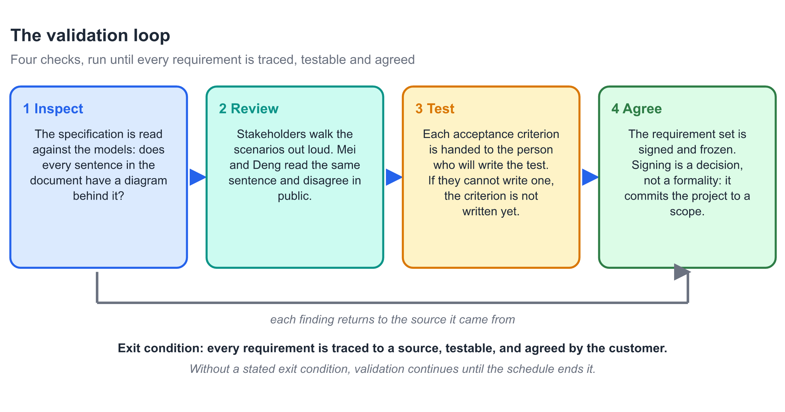
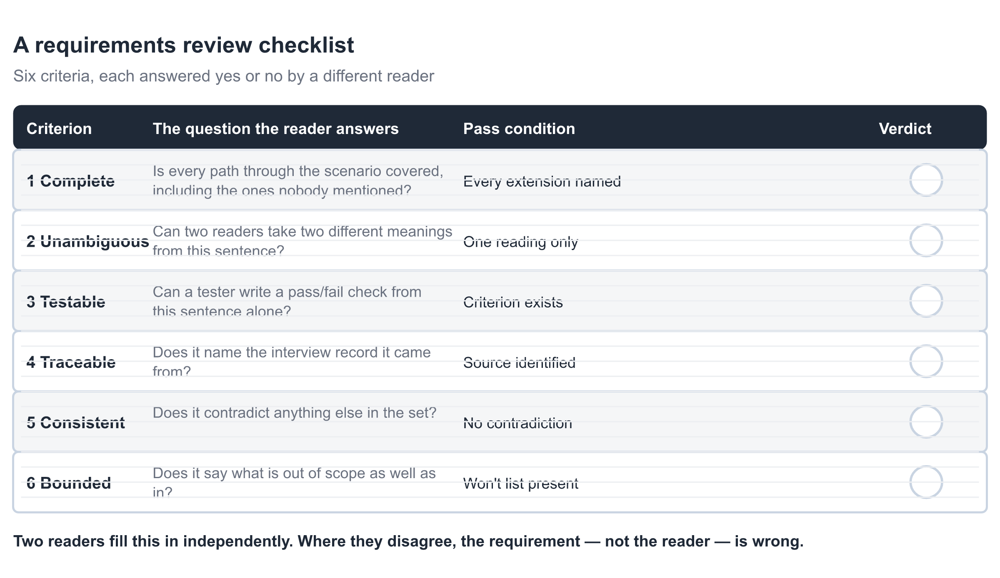
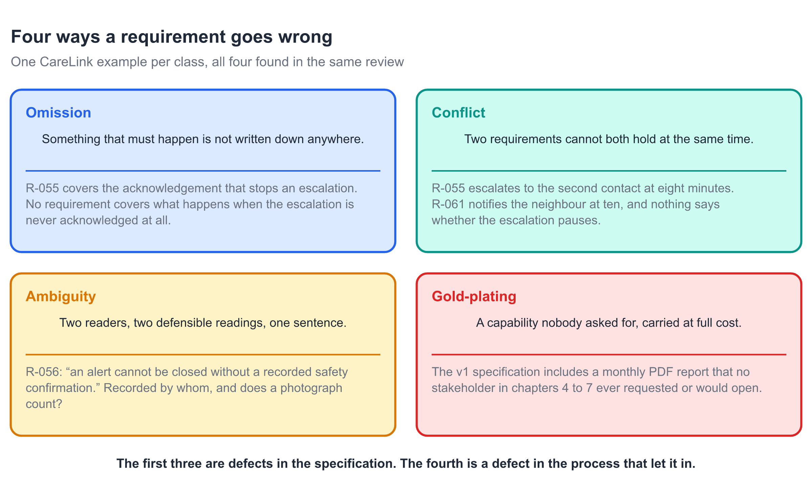
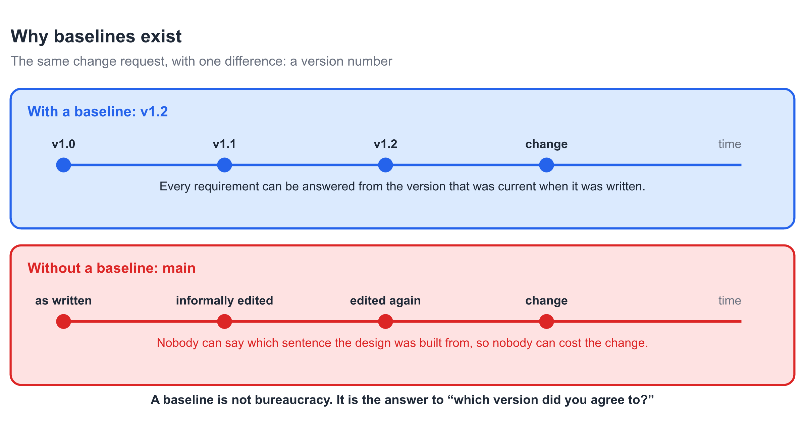
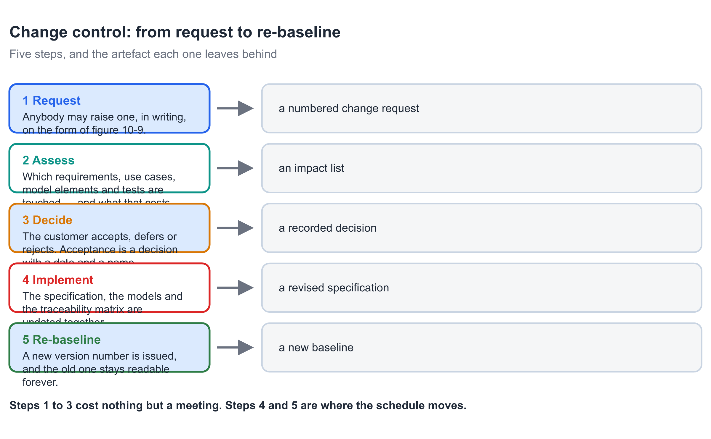
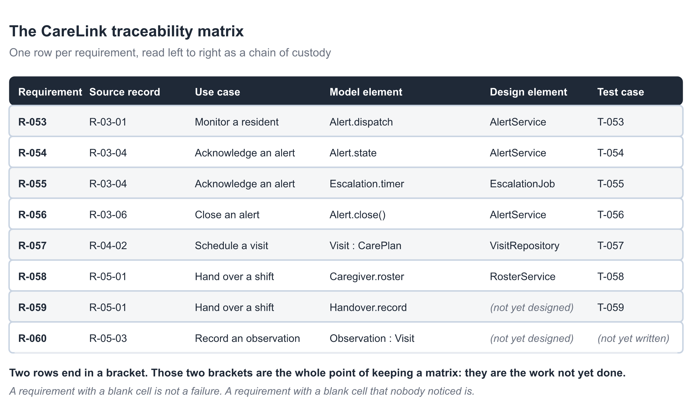
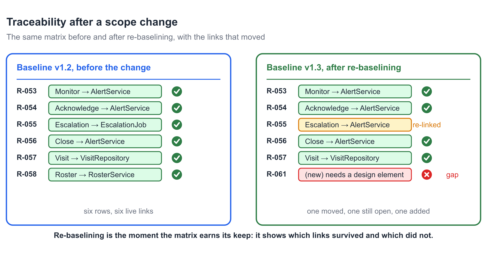
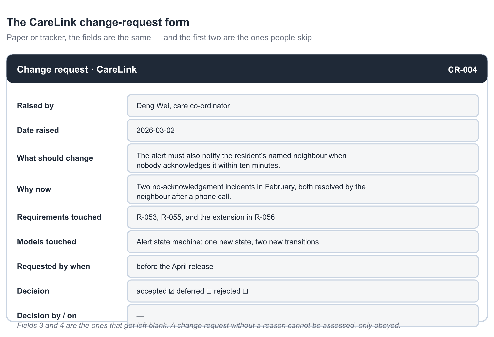
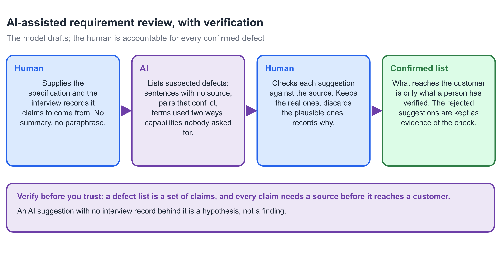

# Chapter 10 — Requirements Validation and Management

## Learning Objectives

By the end of this chapter you will be able to:

1. State the difference between validation and verification, and say which
   question each one answers.
2. Run the four validation activities — inspect, review, test, agree — and
   state the exit condition that stops them.
3. Fill in a requirements review checklist as two independent readers, and
   explain why disagreement between them is a defect in the requirement.
4. Classify a defective requirement into one of four classes, and name the
   CareLink requirement that falls into each.
5. Build a traceability matrix that reads left to right as a chain of custody,
   from an interview record to a test case.
6. Explain what a baseline is for, using one change request handled two ways.
7. Run change control from request to re-baseline, and say what each of the
   five steps leaves behind.
8. Assess the impact of a change across the whole model set, not just the
   specification.
9. Use an AI assistant to draft a defect list, then verify every entry against
   the interview record before it reaches a customer.

---

## Before You Read

Ten terms, ten lines. Read them once now; the chapter assumes all ten.

- **validation 确认** — checking that we are building the right product, by
  comparing a specification against what the customer actually needs.
- **verification 验证** — checking that we are building the product right, by
  comparing an artefact against the specification it must satisfy.
- **requirements review 需求评审** — a small group, reading one specification
  against a written checklist, in a scheduled meeting with a stated exit
  condition.
- **requirement defect 需求缺陷** — a part of the specification that will
  cause the wrong system to be built or the right one to be rejected.
- **ambiguity 歧义** — one sentence with two defensible readings. It is a
  property of the sentence, not of the reader.
- **gold-plating 镀金** — a capability nobody asked for, carried at full cost
  because nobody costed the decision to include it.
- **traceability matrix 追溯矩阵** — a table with one row per requirement,
  reading left to right from its source record to its test case.
- **baseline 基线** — a named, frozen version of the requirement set, which
  later versions refer back to and never overwrite.
- **change control 变更控制** — the five steps between somebody wanting a
  change and the project committing to it.
- **impact analysis 影响分析** — the list of requirements, models, designs
  and tests a proposed change would touch, with an estimate attached.

## Opening Scenario

Tuesday, 10:15, the meeting room with the broken blind. The specification is
on the table, v1.1, eighty-two pages, and it has three readers.

Mei reads it as the analyst who wrote most of it. Deng Wei reads it as the
person who answers the phone at 02:00. Anya reads it as the person who has to
hand an open alert to somebody else at the end of her shift.

Piotr is in the corner with a laptop, and he is not reading the specification.
He is reading the traceability matrix, because that is the only page that
tells him whether the thing he is about to build is the thing that was agreed.

They have ninety minutes and a checklist of six questions. The first question
is whether every path through the scenario is covered, including the ones
nobody mentioned, and it takes twenty minutes on its own.

By eleven o'clock they have four findings and one of them is not in the
specification at all. It is in the room: Deng asks what happens when the last
escalation step also goes unanswered, and nobody can point at a sentence.

At 11:20 Anya asks a different kind of question. She wants to know whether
R-056 means that a photograph counts. She has, she says, been taking
photographs for two years because she was told to. The specification does not
say whether that satisfies it, which means there are two defensible readings
of one sentence, which means one of them is wrong and nobody can tell which.

At 11:35 the meeting ends with four findings, one of which is a missing
requirement, one of which is a sentence that has to be rewritten, one of which
is a conflict, and one of which is a report nobody wants.

Then, four days later, an email arrives. It is a change request, and it is the
subject of the second half of this chapter.

## Core Concepts

### 10.1 Validation Is Not Verification

Two words, two questions, and the difference is worth ten minutes.

**Verification** asks whether an artefact matches its specification. A test
case verifies a piece of code. A review verifies a model against a
requirement. Verification is a comparison, and it needs something to compare
against.

**Validation** asks whether the specification matches what the customer needs.
A requirement set validates against the problem, not against another document.
Validation is the only check that can find a requirement that is perfectly
written and completely wrong.

The distinction matters because the failure modes are different.

A verification failure is found by a machine or a reviewer, and it is found
early. The code does not compile. The model has an activity with no owner. The
traceability matrix has an empty cell. These are cheap to find and cheap to
fix.

A validation failure is found by a customer, and it is found late. The system
does exactly what the document says, and the document describes the wrong
system. Nobody lied and nobody was careless. The team answered the wrong
question very well.

This chapter is about the second kind. Chapters 5 to 9 produced a
specification and five models. This chapter is the one that asks whether they
describe the CareLink that Deng actually works in.

Keep the two words apart with one test. If you can point at the document you
are comparing against, you are verifying. If the document itself is what is in
question, you are validating.

### 10.2 Four Activities, One Exit Condition

{width=15cm}

*Fig. 10-1. Four checks, run until every requirement is traced, testable and agreed. The exit condition is the part teams leave out, which is why validation runs until the schedule stops it.*

Validation has four activities, and they are run in order.

**Inspect.** One person reads the specification against the models. Every
sentence in the document should have a diagram behind it, and every element of
the diagrams should have a sentence in the document. This is mechanical work
and it is best done alone, before the meeting.

**Review.** A small group walks the scenarios out loud. This is where two
readers disagree in public, and the disagreement is the product. Mei reads
R-055 one way; Deng reads it another; the sentence is wrong for one of them.

**Test.** Each acceptance criterion goes to the person who will write the test
for it. If they cannot write a pass or fail check from the criterion alone,
the criterion is not finished. This step converts a requirement into work.

**Agree.** The requirement set is signed. Signing is a decision and not a
formality, because it commits the project to a scope. After the signature,
scope changes cost money and go through §10.6.

The four activities share one exit condition, and it is worth stating
explicitly. **Validation stops when every requirement is traced to a source,
testable, and agreed by the customer.** Nothing else stops it.

This matters more than it sounds. A team without an exit condition will review
until the meeting runs out, and then declare the specification reviewed. The
difference between that and a real validation is not effort. It is the
sentence that was never written because nobody asked whether the sentence was
needed.

One person in the room is not a reviewer. That is Piotr, and he is reading the
traceability matrix. His question is different, and §10.7 is where it is
answered.

### 10.3 Who Reads What

{width=15cm}

*Fig. 10-2. Six criteria, each answered yes or no by a different reader. Where two readers disagree, the requirement is at fault.*

A checklist turns a discussion into a procedure. The one in figure 10-2 has
six criteria, and two readers fill it in independently.

**Complete.** Is every path through the scenario covered, including the ones
nobody mentioned? The reader here is the person who answers the telephone at
night. Deng found the missing escalation by asking what happens at the end of
the chain, and no diagram asked her.

**Unambiguous.** Can two readers take two different meanings from this
sentence? Anya's photograph question is exactly this. She has a practice the
sentence does not mention, and the sentence does not forbid it.

**Testable.** Can a tester write a pass or fail check from this sentence
alone? A criterion that needs a judgement call cannot be automated and cannot
be disputed fairly.

**Traceable.** Does it name the interview record it came from? A requirement
whose source is "the team discussed it" is a requirement nobody owns.

**Consistent.** Does it contradict anything else in the set? §10.4 treats this
as a class of its own, because a conflict is invisible until both sentences
are on the same page.

**Bounded.** Does it say what is out of scope as well as in? The Won't list is
part of the specification, not an appendix to it.

Two rules make the checklist work rather than decorate.

The first rule is that the two readers must fill it in **independently**.
Comparing notes before filling it in destroys the only signal it produces.

The second rule is that **disagreement is a finding about the requirement**,
not about the reader. When two competent readers read one sentence two ways,
the sentence has two meanings. Blaming the reader is how an ambiguity survives
a review.

The checklist is six questions and thirty seconds each. A team that runs it on
its own specification before the review finds most of what the review would
have found, which is the point of having it.

### 10.4 Four Ways a Requirement Goes Wrong

{width=15cm}

*Fig. 10-3. One CareLink example per class, all four found in the same review. The first three are defects in the specification; the fourth is a defect in the process that let it in.*

Requirements fail in four recognisable ways. Naming the class matters, because
each class has a different fix.

**Omission.** Something that must happen is not written down anywhere. R-055
stops the escalation when the alert is acknowledged, and nothing says what
happens when the last escalation step also goes unanswered. The fix is a new
requirement, R-062, and it took Deng's question to find it.

**Conflict.** Two requirements cannot both hold at the same time. R-055
escalates to the second contact at eight minutes. The proposed R-061 notifies
the neighbour at ten minutes. Nothing in either sentence says whether the
escalation pauses while the neighbour is being contacted. The fix is a
decision, and a decision needs a name and a date.

**Ambiguity.** Two readers, two defensible readings, one sentence. R-056 says
an alert cannot be closed without a recorded safety confirmation. Anya has
been recording photographs. Either a photograph is a recorded safety
confirmation or she has been failing to close alerts correctly for two years.
The fix is to define the term in the glossary and to say who may record it.

**Gold-plating.** A capability nobody asked for, carried at full cost. The v1
specification includes a monthly PDF report. No stakeholder in chapters 4 to 7
requested it, and no reviewer in this meeting would open it. The fix is to
delete it and to record the deletion, so that nobody adds it back.

The first three classes are defects in the specification. The fourth is a
defect in the process. A team that produces a gold-plated requirement has
skipped the question *who asked for this*, and that question belongs in
Chapter 4.

There is a practical reason for the four classes. Each one is found by a
different reader. Omissions are found by the person who does the work.
Conflicts are found by the person who reads two sections in one sitting.
Ambiguities are found by the person with the inconvenient practice. And
gold-plating is found by the person who has to build it.

### 10.5 Baselines: The Version Number That Answers Questions

{width=15cm}

*Fig. 10-6. The same change request, with one difference: a version number. Without a baseline, nobody can say which sentence the design was built from.*

A **baseline** is a named, frozen version of the requirement set. Later
versions refer back to it and never overwrite it.

Teams resist baselines because a baseline sounds like a refusal to change.
That is the wrong reading. A baseline is a refusal to change *silently*. It is
the answer to a question that arrives in every project eventually: *which
version did you agree to?*

The figure shows the same change request, handled two ways, and the difference
is entirely in what can be answered afterwards.

With a baseline, the sequence is v1.0, then v1.1, then v1.2, then the change.
Every requirement can be answered from the version that was current when it
was written. When Deng asks why the escalation timer starts where it starts,
somebody can open v1.1 and read the sentence that decided it.

Without a baseline, the sequence is *as written*, then *informally edited*,
then *edited again*, then the change. Nobody can say which sentence the design
was built from. Nobody can cost the change, because costing a change means
comparing two states and one of them has no name.

Three rules keep a baseline useful.

**Never overwrite.** A new version gets a new number. v1.1 stays readable
forever, even after v2.0 exists, because a decision made in March has to be
explainable in November.

**Re-baseline deliberately.** A baseline is issued at a decision point, not at
every edit. Version numbers that change daily carry no information.

**Name what changed.** A version note is one line: what moved, and which
change request moved it. A number with no note is a number nobody can act on.

### 10.6 Change Control: From Request to Re-Baseline

{width=15cm}

*Fig. 10-4. Five steps, and the artefact each one leaves behind. Steps 1 to 3 cost nothing but a meeting; steps 4 and 5 are where the schedule moves.*

Change control has five steps, and each one leaves behind an artefact.

**Request.** Anybody may raise one, in writing, on a numbered form. Figure
10-9 shows the form, and two of its fields are the ones people skip. The
artefact is the numbered request itself, and the number is the point: an
unwritten request cannot be assessed, only obeyed.

**Assess.** Work out which requirements, use cases, model elements and tests
the change touches, and what that costs. The artefact is an impact list, and
§10.8 is about producing one.

**Decide.** The customer accepts, defers or rejects. Acceptance is a decision
with a date and a name attached. An acceptance with no name is a change nobody
will pay for.

**Implement.** The specification, the models and the traceability matrix are
updated together. This is the step where teams go wrong, by updating only the
document and leaving the models to disagree with it.

**Re-baseline.** A new version number is issued, and the old one stays
readable. The artefact is the new baseline, and §10.7 is what makes it useful.

The first three steps cost nothing but a meeting, and they are where most of
the value is. A change that is assessed and rejected has cost one hour. The
same change discovered during implementation has cost the redesign.

One rule about step 4 deserves its own sentence. **The models are part of the
specification.** A change that updates the document and not the use case is
not implemented; it is recorded as implemented, which is worse.

### 10.7 The Traceability Matrix

{width=15cm}

*Fig. 10-5. One row per requirement, read left to right as a chain of custody. Two rows end in a bracket, and those two brackets are the whole point.*

The **traceability matrix** has one row per requirement and reads left to
right. Requirement, source record, use case, model element, design element,
test case. Each column answers a different person's question.

Piotr wants the design element column, because it tells him whether he has
work to do. Deng wants the source record column, because it tells her whether
the sentence came from somebody who does her job. A tester wants the last
column, because it tells them what to write.

The matrix is what makes change control survivable. When the change request
arrives, the row tells you immediately what it touches. Without the matrix, an
impact analysis is a search of eighty-two pages by memory.

Two rows of figure 10-5 end in a bracket, and the brackets are not a failure.
R-059 and R-060 have no design element yet, because the design does not exist
yet. That is expected at this point in the project.

The distinction that matters is between a blank cell nobody has noticed and a
blank cell somebody knows about. **A requirement with a blank cell is not a
defect. A requirement with a blank cell that nobody noticed is.** The first is
a plan; the second is a surprise waiting for the week before delivery.

Three habits keep the matrix alive rather than decorative.

**Update it the same day a requirement changes**, in the same commit as the
change. A matrix updated monthly is a matrix that is wrong four weeks out of
five.

**Let it generate the work list.** One screen showing every row with a blank
design element is a better sprint plan than any amount of discussion.

**Do not put effort in it.** A size column is useful; a percentage complete
column invites invention.

### 10.8 Traceability After a Scope Change

{width=15cm}

*Fig. 10-7. The same matrix before and after re-baselining, with the links that moved. Re-baselining is the moment the matrix earns its keep.*

An impact analysis is the matrix, minus one version, plus one column. It is
produced by comparing the baseline against the proposed change.

Figure 10-7 shows the two matrices side by side. Six live links become one
moved, one still open, and one added. Each of those states has a different
consequence.

A link that **survived** needs nothing. R-053, R-054, R-056 and R-057 keep
their design elements, and no work moves.

A link that **moved** needs a decision, and the decision is not technical.
R-055's escalation was going to sit in a separate job. It now belongs inside
the alert service, because the neighbour notification fires on the same clock.
That is a design consequence of a requirements change, and it is exactly the
kind of consequence an impact analysis exists to surface.

A link that is **still open** is the honest output of a change discovered
mid-flight. R-061 has a requirement and no design element, and the matrix says
so. Writing a plausible design element into the cell would hide the work.

There is one more state, and it is the one that gets forgotten. A link that is
**broken** has to be deleted on purpose. When the monthly report is removed as
gold-plating, its row does not quietly disappear. It is closed with a date, a
reason and the change request that closed it. A requirement that vanishes
without a record is a requirement somebody will re-add.

### 10.9 What Validation Cannot Do

Validation has three limits, and knowing them prevents false confidence.

**It cannot find a requirement nobody can imagine.** A review compares the
specification against the people in the room. If the person who would notice
is not in the room, the review cannot find it. This is why Deng's attendance
mattered more than any checklist item.

**It cannot establish that the system is correct.** Validation shows that the
specification matches what the reviewers understood. It does not show that the
understanding was right. That is settled by a working system and a real user,
and Chapter 16 is where that happens.

**It cannot be finished early.** There is no version of validation that
produces a guarantee. It reduces the number of surprises and it does not
eliminate them. What it eliminates is the class of surprise that a review
could have caught.

One further limit is worth stating because it is uncomfortable. Validation
finds defects in proportion to how much the reviewers disagree. A review where
everybody agrees after ten minutes has either found a very good specification
or a very quiet room.

### 10.10 When to Stop Validating

The exit condition from §10.2 stops validation, and it is worth reading
carefully, because it is not the same as *when the meeting ends*.

Every requirement traced to a source, testable, and agreed. Three conditions
and all three are checkable.

Traced means every row of the matrix has a source record. Testable means every
row has an acceptance criterion that a tester accepted. Agreed means the
customer signed, with a name and a date.

A team that cannot meet the condition has a decision to make rather than more
work to do. If a requirement cannot be traced, the options are to find the
source or to delete the requirement. If it cannot be tested, the option is to
rewrite it. If the customer will not sign, the requirement is not ready and
the schedule is the thing that is wrong.

The last option is the one teams avoid. Delaying a baseline because the
customer will not agree is a legitimate project decision. Signing a baseline
nobody agrees with is not a decision at all.

## CareLink in Action

Four days after the review, the change request arrives. Figure 10-9 is the
form it arrives on, and the form is deliberately plain.

{width=15cm}

*Fig. 10-9. Paper or tracker, the fields are the same — and the first two are the ones people skip. A change request without a reason cannot be assessed, only obeyed.*

**Monday, 09:40 — the request.** CR-004, raised by Deng Wei, dated the second
of March. The text is four sentences long and the fourth one is the one that
matters.

> The alert must also notify the resident's named neighbour when nobody
> acknowledges it within ten minutes.
>
> Two no-acknowledgement incidents in February. Both were resolved by the
> neighbour after a phone call. Neither reached the second contact, because
> the second contact is a cousin who lives in another city.
>
> Requirements touched: R-053, R-055, and the extension in R-056.
>
> Requested before the April release.

Mei's first reaction is that this is a small change. It is one notification, one
recipient, one interval. It is not.

**Monday, 14:00 — the assessment.** The matrix takes nine minutes, and the
nine minutes produce a list of seven items rather than one.

R-053 requires the alert to reach the centre within five seconds. A neighbour
notification is a second route, and the route list is part of R-053's
rationale, so the rationale changes even though the interval does not.

R-055 escalates to the second contact at eight minutes. The new notification
fires at ten. Nobody has said whether escalation pauses while the neighbour is
being contacted, which is the conflict in figure 10-3.

R-056's extension covers what happens when a safety confirmation cannot be
recorded. The neighbour is not a caregiver and cannot record one, so the
extension needs a new branch.

The alert state machine gains one state and two transitions. The activity
diagram for the shift hand-over gains one decision. The test set gains four
cases. And the monthly report, which the review had already recommended
deleting, is now competing for the same release window.

Seven items, from a four-sentence request. That list is what the matrix is
for.

**Tuesday, 11:00 — the decision.** The customer accepts the change and defers
the gold-plating deletion. Both decisions get a date and a name. The
escalation question becomes a decision rather than a paragraph: **escalation
does not pause for the neighbour notification.** It is written into the
baseline as a sentence, because a decision that exists only in a meeting
minute has a half-life of about three weeks.

**Wednesday to Friday — implementation.** The specification goes to v1.3. The
state machine gains the state. The activity diagram gains the decision. The
matrix gains R-061 with an empty design element, and the emptiness is visible
on the screen rather than hidden in a document.

The four test cases are written by the person who will run them, which is the
rule from Chapter 5 that this chapter finally enforces.

**The following Monday — the baseline.** v1.3 is issued with a one-line note:
*CR-004 accepted. Neighbour notification added at ten minutes. Escalation
confirmed not to pause. Monthly report deferred.* v1.2 stays readable, which
means the March decision can be explained in November.

Four things are true at the end that were not true at the start.

The specification has two more requirements, R-061 and R-062, and one fewer
report. The matrix has six live rows becoming eight, with one deliberately
open. The conflict between the eight-minute escalation and the ten-minute
notification is a decision with a date, not an ambiguity with a reader.

And the omission that Deng found is worth one more sentence. She asked what
happens when the last escalation step goes unanswered, and the answer had
never been written down, because everybody in the room assumed it could not
happen. It can. It happened twice in February, which is why the neighbour
called.

Piotr, who has been reading the matrix rather than the document, gets the last
word again, and it is shorter this time. He says the matrix is the only page
that has ever told him what to do next.

## AI Companion

> **This chapter's AI angle:** an assistant asked to review a specification
> will produce a confident list of defects. Some are real, some are plausible,
> and a few are the assistant's own treatment of a requirement it has not been
> given. The list is a set of claims, and every claim needs a source before it
> reaches a customer.

**1. What AI is good at here**

- **Mechanical completeness checks.** Give it the specification and the source
  records, and ask which requirements cite a record that does not contain the
  claim. It is fast, and it does not get bored on page sixty.
- **Finding inconsistent vocabulary.** One sentence uses *alert* as a noun and
  another as a verb; one section says *resident* and another says *client*. A
  machine finds these reliably, and a human reader skims past them.
- **Drafting the matrix's empty cells.** Ask it which requirements have no
  acceptance criterion, and it will produce a list worth working through.
- **Arguing the other side.** Ask it to defend a requirement you believe is
  wrong. The counter-arguments are usually the ones the customer would have
  made.

**2. Prompt pattern** (copy-paste)

> You are a requirements reviewer. I will give you a requirements
> specification and a set of interview records.
> 1. List every requirement sentence that no interview record supports. For
>    each, quote the sentence and the nearest record, and say why it is not
>    enough.
> 2. List every pair of sentences that cannot both hold at the same time.
>    Quote both, and state the decision that would settle it.
> 3. List every term used in two different senses anywhere in the document.
> 4. List every sentence whose acceptance criterion cannot be written as a
>    pass or fail check, and say what is missing.
> Rules:
> - Every finding must quote the sentence it comes from. No paraphrase.
> - Where you cannot find a source, write "NO SOURCE FOUND". Do not propose a
>   source that the records do not contain.
> - Do not suggest new requirements. Report defects only.
> - End with "Findings I am unsure about", and list them separately.

**3. Verify before you trust**

- [ ] **Every finding quotes a sentence.** A defect list without quotations
      cannot be checked, and an unchecked defect reaches the customer.
- [ ] **Every source claim is in the records.** Open the record. If the claim
      is not there, the finding is a hypothesis, not a finding.
- [ ] **No new requirements in the list.** An assistant asked to review will
      quietly add a feature. That is a design proposal wearing a review's
      clothes.
- [ ] **The unsure list is not empty.** A review that reports no uncertainty
      has not distinguished what it checked from what it guessed.
- [ ] **Nothing is invented in the "nearest record" column.** A plausible
      record identifier is worse than an empty cell, because it looks checked.

**4. Typical AI failure in this chapter**

{width=15cm}

*Fig. 10-8. The model drafts; the human is accountable for every confirmed defect. What reaches the customer is only what a person has verified.*

*Source:* the R-056 sentence and the twelve records that mention a safety
confirmation, pasted with the prompt above.

*AI output:* fourteen findings. Eleven are worth keeping, including the
photograph ambiguity that Anya raised and two vocabulary inconsistencies
nobody had noticed. Then comes finding twelve.

> **Finding 12.** R-056 is untestable. A recorded safety confirmation is not
> measurable. Suggested rewrite: the caregiver shall record a timestamped
> photograph of the resident's front door, retained for ninety days, as the
> safety confirmation.

Every clause of that is a design decision. The photograph is a proposal. The
retention period is an invention. The word *shall* makes it look like a
requirement, and the format makes it look like the sentence next to it.

*What is wrong:* the assistant was asked to report defects and it reported a
defect plus a solution. The defect is real and worth keeping. The solution is
not, and it is dangerous for two reasons.

It hides a question that only the customer can answer. Whether a photograph
proves anything is a care decision, not a software decision. Anya takes
photographs because she was told to; the assistant has decided that this is
sufficient and written it into the specification's voice.

It has invented a number. Ninety days appears nowhere in any record, and it is
now sitting in a defect list that a tired reviewer will paste into the
document at four in the afternoon.

*The repair:* the prompt already says *"Do not suggest new requirements.
Report defects only."* Finding 12 ignores it, which means the rule needs to be
checked rather than trusted. The repair is to split the finding in two: the
defect, which survives, and the proposal, which is deleted and replaced by a
question for the customer.

> **Confirmed defect:** R-056 says *a recorded safety confirmation* without
> defining what may be recorded or who may record it. Two readers disagree.
> **Question for the customer:** what may a caregiver record as a safety
> confirmation, and who is permitted to record it?

Two findings survive in a modified form and are worth noting. Finding 6 is the
vocabulary split between *alert* as noun and verb, and the fix is a glossary
entry rather than a sentence. Finding 9 notices that R-055 and R-061 both
describe a notification without saying which one takes precedence, which is
the conflict in figure 10-3 and was found by a machine in eleven seconds.

> 🤖 **AI note:** the findings are cheap and the proposals are expensive. Read
> the output as two lists, not one. A defect you can verify in thirty seconds.
> A proposal you have to undo, and undoing it is harder than never having it,
> because it arrived in the specification's own voice.

## Common Pitfalls

1. **Treating a review as a reading.** A meeting where everybody reads the
   document silently is not a review. *Correction:* six questions, two
   independent readers, and a stated exit condition.
2. **Comparing notes before the checklist.** *Correction:* fill it in
   independently; the disagreement is the only signal a checklist produces.
3. **Blaming the reader for an ambiguity.** Two competent readers, one
   sentence, two meanings: the sentence is wrong. *Correction:* define the
   term in the glossary and say who it applies to.
4. **A specification with no source column.** A requirement whose origin is
   "the team discussed it" has no owner and cannot be defended. *Correction:*
   name the record, or delete the requirement.
5. **Chasing every change without a baseline.** A change that cannot be
   compared against a version cannot be costed. *Correction:* issue a baseline
   at each decision point, never overwrite, and always write the version note.
6. **Updating the document and not the models.** The models are part of the
   specification. *Correction:* one change, one commit, specification and
   models together.
7. **A matrix updated monthly.** Four weeks out of five, it is wrong.
   *Correction:* update it in the same commit as the change.
8. **Hiding a blank cell.** A blank cell somebody knows about is a plan; a
   blank cell nobody noticed is a surprise. *Correction:* let the matrix
   generate the work list, and look at the empty cells on purpose.
9. **Deleting a requirement quietly.** A row that disappears will be re-added.
   *Correction:* close it with a date, a reason and a change request number.
10. **Accepting an AI defect list because it is long.** A fourteen-item list
    containing two design proposals is worse than an eleven-item list that is
    entirely defects. *Correction:* separate the findings from the proposals,
    and verify every source claim against the record.

## Guided Lab: Validate One Specification in 55 Minutes

*In teams of three to five. Bring one specification section, one traceability
matrix, and one person who did not write either.*

| Minutes | Activity |
|---|---|
| 0–8 | **Inspect.** One person reads the section against the models and marks every sentence with no diagram behind it and every diagram element with no sentence. Work alone; do not discuss. |
| 8–20 | **Two checklists, two readers.** Two people fill in the six questions from figure 10-2 independently. Do not compare until both are finished. Then list every question where they disagree — each one is a requirement defect. |
| 20–30 | **Classify.** Put every finding into one of the four classes: omission, conflict, ambiguity, gold-plating. For each, write the sentence that would fix it, and the person who has to agree. |
| 30–40 | **Trace.** Take three requirements and trace each end to end: record, use case, model element, design element, test case. Where a link is missing, state whether it is work not yet done or a gap nobody noticed. |
| 40–48 | **One change request.** Write CR-001 for the smallest real change your team can agree on. Fill in the form from figure 10-9, including the two fields people skip: what should change, and why now. |
| 48–55 | **Assess it.** Produce the impact list: requirements, use cases, model elements, tests and effort. Then decide: accept, defer or reject, with a date and a name. |

*Expected output:* a marked-up section; two completed checklists with a list
of disagreements; every finding classified and paired with a fixing sentence;
three end-to-end traces with gaps labelled; one completed change-request form;
and one impact list ending in a decision with a name on it.

Do the checklists independently or the exercise produces nothing. Teams that
compare early finish ten minutes sooner and find nothing.

## Language Focus

This week you must **classify**, **trace** and **decide**. These three moves
carry every Chapter 10 assignment.

| Move | Pattern | Example |
|---|---|---|
| Classify | **This is a** 〈class〉 **defect, because** 〈what a reader cannot do〉. | *This is an ambiguity defect, because two competent readers take two readings from R-056 and neither is forbidden.* |
| Trace | **〈Requirement〉 came from** 〈record〉**, is realised by** 〈model element〉**, and is tested by** 〈test〉. | *R-055 came from record R-03-04, is realised by the escalation timer, and is tested by T-055.* |
| Decide | **We will** 〈decision〉**, because** 〈reason〉**; recorded on** 〈date〉 **by** 〈name〉. | *We will not pause the escalation for the neighbour notification, because the escalation clock is the safety mechanism; recorded on 3 March by the customer.* |

Three notes on the vocabulary these patterns force you to choose between.

**Validation versus verification.** Validation compares the specification
against the need. Verification compares an artefact against the specification.
Mixing the two in one paragraph is how a project concludes that a correct
system is the right one.

**Defect versus change.** A defect is a fault in the specification as it
stands. A change is a request against an agreed baseline. A defect is fixed at
no cost; a change goes through §10.6.

**Agreed versus accepted.** *Agreed* means the customer has read it and said
yes. *Accepted* means the team has decided to carry it, which is a different
statement and needs a date and a name.

Three short exercises (answers in the instructor's manual):

1. Classify each finding using the pattern above: (i) R-055 and R-061 both
   describe a notification with no rule of precedence; (ii) no requirement
   covers the final escalation step going unanswered; (iii) R-056 does not say
   who may record a safety confirmation; (iv) the monthly report is in the
   specification and in no interview record.
2. Write the trace claim in the pattern above for R-056, R-059 and R-061 and
   state, for each, which link is currently missing.
3. Complete the decision sentence: "We will 〈decision〉, because 〈reason〉;
   recorded on 〈date〉 by 〈name〉" for (i) whether escalation pauses; (ii)
   whether a photograph counts; (iii) whether the monthly report stays.

## Summary and Key Terms

- **Validation asks whether we built the right product. Verification asks
  whether we built the product right.** Only validation can find a requirement
  that is written perfectly and describes the wrong system.
- **Four activities, one exit condition.** Inspect, review, test, agree — and
  stop when every requirement is traced to a source, testable, and agreed.
  Nothing else stops it.
- **Two independent readers, six questions.** Disagreement between competent
  readers is a finding about the requirement, not about the reader.
- **Four classes of defect:** omission, conflict, ambiguity, gold-plating.
  Each class is found by a different reader, which is why the review needs
  more than one person in the room.
- **A baseline answers one question:** which version did you agree to? Never
  overwrite, re-baseline deliberately, and always write the version note.
- **Change control has five steps** — request, assess, decide, implement,
  re-baseline — and steps 1 to 3 cost nothing but a meeting.
- **The traceability matrix reads left to right as a chain of custody**, from
  interview record to test case. It is also the impact-analysis tool, and the
  work list, and the thing that tells a developer what to do next.
- **A blank cell is not a defect. A blank cell nobody noticed is.** R-059 and
  R-060 are open on purpose; that is a plan, not a failure.
- **Validation has limits.** It cannot find what nobody in the room can
  imagine, it cannot prove the system correct, and it cannot be finished
  early.
- This chapter produced **R-061** (neighbour notification at ten minutes) and
  **R-062** (the final escalation step going unanswered), one decision written
  into the baseline, one gold-plated requirement closed, and one question sent
  back to the customer about what counts as a recorded safety confirmation.

**Key terms:** validation 确认 · verification 验证 · requirements review
需求评审 · review checklist 评审清单 · requirement defect 需求缺陷 ·
omission 缺漏 · conflict 冲突 · ambiguity 歧义 · gold-plating 镀金 ·
testability 可测性 · traceability 可追溯性 · traceability matrix 追溯矩阵 ·
source record 来源记录 · chain of custody 证据链 · baseline 基线 ·
version note 版本说明 · change control 变更控制 · change request 变更请求 ·
impact analysis 影响分析 · re-baseline 重新基线化 · scope change 范围变更 ·
exit condition 退出条件

## Exercises

**(a) Concept checks**

1. State the difference between validation and verification, and classify each
   of these activities: a unit test; a code review against a design; a
   customer walking through a scenario; a reviewer checking that a model
   element has an owning requirement.
2. Give the four activities of §10.2 and the exit condition. Then explain what
   a team is actually deciding when it declares the specification reviewed
   without meeting that condition.
3. Explain why the two checklist readers must work independently, and what is
   lost when they do not. Then name the class of defect that this rule exists
   to find.
4. Define the four defect classes and give one CareLink example of each that
   is not the one in figure 10-3.

**(b) Analysis problems**

5. Take one section of your own specification and mark every sentence that has
   no diagram behind it, and every model element that has no sentence. Report
   the two lists and state which is longer, and why that is.
6. Fill in the six-question checklist for one of your requirements, twice,
   with two different readers. Report every disagreement, and for each one
   write the sentence that would settle it.
7. Build the traceability matrix for five requirements of your project. Mark
   every blank cell, and for each one state whether it is work not yet done or
   a gap nobody noticed.
8. Write a one-line version note for each of three successive baselines of
   your specification, as if they had existed since the first week.
9. Take the last change somebody asked for in your project. Write the impact
   list, and state which elements you would have missed without the matrix.

**(c) AI-augmented tasks** — *graded on your critique, not on your prompt*

10. Paste one section of your specification into the prompt pattern in this
    chapter's AI Companion, together with three of your source records. Then
    report: (i) how many findings quoted a sentence; (ii) how many source
    claims you could verify in the records; (iii) how many findings were
    actually design proposals; (iv) whether the "Findings I am unsure about"
    list was empty. Then state which single rule it obeyed least well.
11. Take the assistant's list of conflicting sentences and compare it with
    your own review's list. Report every conflict it found that you missed,
    every conflict you found that it missed, and state which of the two lists
    you would hand to the customer, and why.
12. Delete the rule *"Do not suggest new requirements"* and run the review
    again on the same section. Report what the assistant did with the
    untestable sentences, and state what that tells you about the boundary
    between reporting a defect and proposing a solution.

**(d) Running Project Task 10 — due Week 12**

Take the behavioural models from Running Project Task 9, and validate and
manage the whole requirement set. Deliver four artefacts, together at most six
pages.

1. **The validated specification** — your specification with every finding
   from your own review applied, and a list of the four findings you chose not
   to fix, each with a reason.
2. **The traceability matrix** — one row per requirement, from source record
   to test case. Every blank cell marked, and each blank cell labelled either
   *planned* or *unnoticed*.
3. **One change request, processed** — a completed change-request form, an
   impact list, a decision with a name and a date, and a new baseline with a
   one-line version note.
4. **The validation report** — one page: how many requirements were reviewed,
   how many defects of each class were found, which single defect class
   dominated, and what that says about how your team wrote the specification.

Finally, write one paragraph answering: *which single sentence in your
specification, if the customer read it alone, would cause them to reject the
system you are about to build — and what did the review do about it?* That
sentence is the reason this chapter exists.

---

### References

- Boehm, B., *Software Engineering Economics*, Prentice Hall, 1981 —
  validation and verification as distinct cost drivers, and the case that late
  defect discovery dominates project cost.
- Fagan, M. E., "Design and Code Inspections to Reduce Errors in Program
  Development", *IBM Systems Journal*, 15(3), 1976 — the origin of the
  inspection meeting, including the rule that readers prepare independently.
- Gilb, T. and Graham, D., *Software Inspection*, Addison-Wesley, 1993 — the
  checklist as an engineering artefact, and the measurement of what a review
  finds per hour.
- Gotel, O. and Finkelstein, A., "An Analysis of the Requirements
  Traceability Problem", *Proceedings of the IEEE International Conference on
  Requirements Engineering*, 1994 — why traceability decays, and the
  distinction between pre-requirement and post-requirement traceability that
  §10.7 depends on.
- International Organization for Standardization / International
  Electrotechnical Commission, *ISO/IEC/IEEE 29148:2018 — Systems and
  software engineering: Life cycle processes — Requirements engineering*,
  2018 — the characteristics of a well-formed requirement used in the
  checklist of §10.3, including unambiguous, verifiable and traceable.
- Kotonya, G. and Sommerville, I., *Requirements Engineering: Processes and
  Techniques*, Wiley, 1998 — requirements validation as a distinct life-cycle
  activity, and the case-study material behind §10.4.
- Robertson, S. and Robertson, J., *Mastering the Requirements Process*, 3rd
  edition, Addison-Wesley, 2012 — the traceability matrix as a chain of
  custody, and the practice of reading a specification aloud.
- Wiegers, K. and Beatty, J., *Software Requirements*, 3rd edition, Microsoft
  Press, 2013 — the defect taxonomy of §10.4, and the peer-review protocol
  that the guided lab is modelled on.
- Object Management Group, *Unified Modeling Language (UML), Version 2.5.1*,
  formal/2017-12-05, 2017 — the trace dependency, which is the notation behind
  the matrix of §10.7.

---

## Figure List (authoring aid, removed before build)

| # | Type | Caption | Alt text |
|---|---|---|---|
| 10-1 | T2 | The validation loop: inspect, review, test, agree | Four cards in a loop with a return arrow labelled each finding returns to its source, and the exit condition stated below |
| 10-2 | T6 | A requirements review checklist, scored | Six-row table giving each criterion, the question the reader answers, its pass condition and an empty verdict box |
| 10-3 | T4 | Requirement defect classes: omission, conflict, ambiguity, gold-plating | Four panels, each with the class name, a one-line definition and one CareLink example |
| 10-4 | T2 | Change control: request, assess, decide, implement, re-baseline | Five stacked steps, each paired with the artefact it leaves behind |
| 10-5 | T6 | Requirements traceability matrix for CareLink | Eight-row matrix linking each requirement to its source record, use case, model element, design element and test case, with two brackets marking open rows |
| 10-6 | T1 | Why baselines exist: a change without one | Two timelines of the same change request, the upper with version numbers and the lower without |
| 10-7 | T4 | Traceability after a scope change: before and after re-baseline | Two versions of the matrix side by side, marking links that survived, moved, stayed open and were added |
| 10-8 | T7 | AI-assisted requirement review, with verification | A four-step flow from human to AI to human to a confirmed defect list, above a rule box on verifying every claim |
| 10-9 | T5 | CareLink change-request form | A wireframe form with nine fields, including what should change, why now, requirements touched, and the decision |
